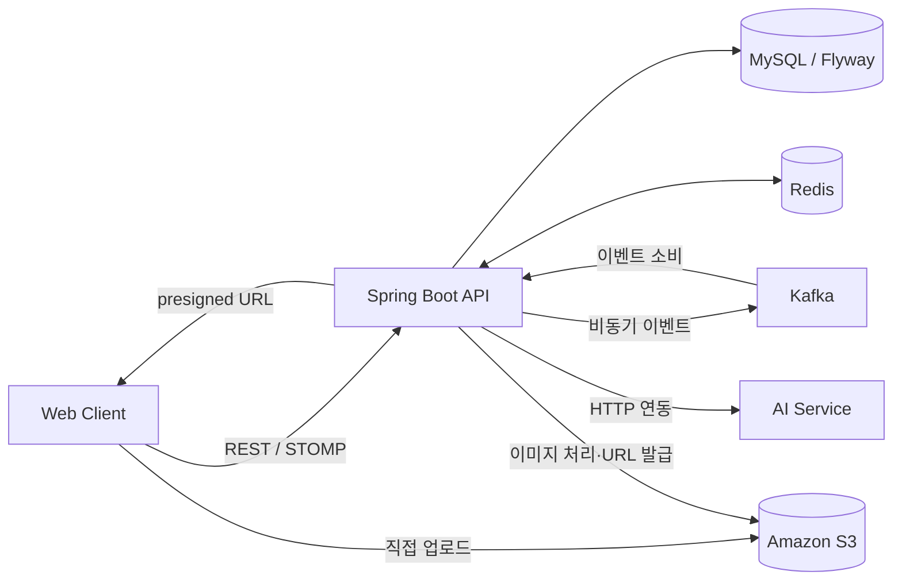

# 바꾸까 Backend

> 그룹 안에서 물품을 등록하고 교환 요청과 채팅으로 연결하는 서비스의 Spring Boot 백엔드입니다.

[Backend Repository](https://github.com/100-hours-a-week/KTB4-1st-BE)

## 프로젝트 소개

바꾸까는 그룹 구성원이 필요한 물품을 올리고, 교환 요청과 실시간 대화로 거래를 이어가는 서비스입니다. 이 저장소는 인증, 그룹·물품·교환 도메인과 이미지 저장, 검색·가격 추정 등 외부 AI 연동을 제공합니다.

## 주요 기능

- 카카오 OAuth 로그인, JWT 발급과 Refresh Token 회전
- 그룹 생성·가입, 위치 인증, 사용자 선호도 관리
- 물품 등록·수정·검색·추천, 좋아요와 조회수 관리
- 물품 교환 요청, 상태 변경, 교환 참여자 채팅
- STOMP 기반 실시간 채팅과 사용자 알림
- S3 presigned URL 이미지 업로드, 썸네일 처리와 미완료 업로드 정리
- AI 이미지 분석, 문구 검수, 가격 추정, 검색 후보 순위화와 챗봇 연동

## 기술 스택

| 분류 | 기술 |
| --- | --- |
| 언어·프레임워크 | Java 25, Spring Boot 4, Spring MVC, Spring Security |
| 데이터 | MySQL, Spring Data JPA, Flyway |
| 캐시·메시징 | Redis, Apache Kafka |
| 통신 | REST API, WebSocket/STOMP |
| 파일·AI | AWS S3, 외부 AI 서비스 |
| 배포 | Docker, GitHub Actions, GitHub Container Registry, AWS ECS/CodeDeploy |
| 품질·관측 | JUnit 5, SpotBugs, PMD, Actuator, Prometheus, Sentry |

## 시스템 아키텍처



- MySQL은 회원·그룹·물품·교환·채팅 데이터를 보관하는 원본 저장소입니다. Flyway 마이그레이션 후 Hibernate가 스키마를 검증합니다.
- Redis는 인증 상태와 캐시, 위치 인증, 여러 백엔드 인스턴스 사이의 실시간 메시지 전달에 사용합니다.
- Kafka는 조회·검색 이력과 가격 추정 요청 등 비동기 이벤트를 전달합니다.
- 이미지는 클라이언트가 presigned URL로 S3에 직접 업로드합니다. 미완료 객체 자동 삭제를 위해 S3 Lifecycle에 `pending=true` 객체의 1일 만료 규칙을 설정해야 합니다.

## 폴더 구조

```text
src/main/java/com/example/KTB_Agile_backend/
├── auth, user          # 로그인, 토큰, 사용자
├── group               # 그룹, 가입, 위치 인증
├── item                # 물품, 추천, 가격 추정
├── exchange            # 교환 요청
├── chat, notification  # 채팅, 알림
├── image               # S3 업로드와 이미지 처리
├── ai, search          # AI 연동과 검색
└── common              # 공통 응답, 예외, 설정, 페이지네이션
src/main/resources/db/migration  # Flyway 마이그레이션
src/test/java                    # 단위·서비스·저장소·동시성 테스트
.github/workflows                # PR 검사와 환경별 배포
```

## 서버 설계

| 계층 | 역할 |
| --- | --- |
| Controller | REST·STOMP 요청을 받고 인증 사용자와 입력값 검증 |
| Service | 트랜잭션과 도메인 규칙 처리 |
| Repository | JPA 기반 데이터 조회·저장 |
| Integration | Redis, Kafka, S3, 외부 AI 서비스 연결 |

- 채팅 내역은 커서 기반으로 조회하고, 실시간 메시지는 DB 저장 후 Redis Pub/Sub을 거쳐 각 서버의 STOMP 구독자에게 전달합니다.
- 가격 추정 요청은 물품 저장 트랜잭션에서 Outbox에 기록한 뒤 Kafka로 전달하고, 실패 시 재시도 일정을 관리합니다.
- 물품 목록은 Projection과 묶음 조회를 활용하며, 좋아요·조회수처럼 동시 요청이 가능한 값은 트랜잭션과 원자적 갱신으로 관리합니다.

## API 요약

| 도메인 | 대표 API |
| --- | --- |
| 인증 | `POST /auth/oauth`, `POST /auth/refresh`, `POST /auth/logout` |
| 그룹 | `GET/POST /groups`, `POST /groups/{groupId}/location-verifications` |
| 물품 | `GET/POST /items`, `GET/PUT/DELETE /items/{itemId}`, `GET /groups/{groupId}/items` |
| 교환 | `POST /items/{itemId}/exchange-requests`, `PATCH /exchange-requests/{exchangeRequestId}/status` |
| 채팅 | `GET /chat-rooms`, `GET /chat/rooms/{chatRoomId}/messages`, STOMP `/app/chat/rooms/{chatRoomId}/messages` |
| 이미지·AI | `POST /images/presigned-urls`, `POST /images/ai-analysis`, `POST /search/rank-candidates`, `POST /chatbot/ask` |
| 알림 | `GET /users/me/notifications` |

## 실행 방법

### 사전 요구 사항

- JDK 25
- MySQL과 Redis

기본 `dev` 프로필은 외부 MySQL과 `localhost:6379`의 Redis를 사용합니다. 데이터베이스 연결 정보를 설정하고 실행합니다.

```bash
SPRING_DATASOURCE_URL=jdbc:mysql://localhost:3306/ktb \
SPRING_DATASOURCE_USERNAME=ktb \
SPRING_DATASOURCE_PASSWORD=your-password \
./gradlew bootRun
```

최초 실행 시 Flyway가 스키마를 생성하므로 비어 있는 MySQL 데이터베이스를 사용합니다. 운영 프로필은 `SPRING_PROFILES_ACTIVE=prod`와 운영 환경 변수를 설정합니다.

## 테스트

```bash
./gradlew test
```

인증·사용자·그룹·물품·교환·채팅·이미지 기능을 검증하며, 좋아요 중복 요청과 조회수·가격 추정·교환 상태 갱신의 동시성 테스트를 포함합니다.

## CI/CD

- `dev`, `main` 대상 Pull Request에 백엔드 코드나 빌드 설정 변경이 있으면 Java 25 환경에서 SpotBugs, PMD, 테스트와 ARM64 Docker 빌드 검증을 실행합니다.
- `dev` 브랜치 Push는 ARM64 이미지를 GitHub Container Registry에 게시하고, GitHub OIDC로 발급한 AWS 자격 증명을 사용해 ECS에 배포합니다.
- `main`에 포함된 커밋의 `vMAJOR.MINOR.PATCH` 태그는 운영 이미지를 게시하고 ECS CodeDeploy로 배포합니다.

## 프로젝트 후기

인증, 그룹·물품 도메인, 실시간 채팅과 외부 AI·S3를 하나의 서비스 흐름으로 연결하는 경험을 했습니다. API 동작뿐 아니라 데이터 흐름과 외부 시스템 연동까지 함께 설계하는 과정에서 백엔드 서비스 전반을 다뤄볼 수 있었습니다.
